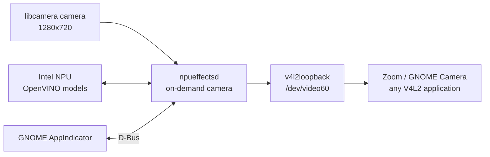

# NpuCamFX

NpuCamFX is a local, on-demand virtual camera for Linux with
NPU-accelerated background blur and skin smoothing. It runs a GStreamer
pipeline on top of Intel NPU through OpenVINO, exposes the result as a
standard V4L2 camera, and provides a GNOME top-bar control with live
previews.

The physical camera is used only while an application is reading the
virtual camera. When the virtual camera is idle, the daemon keeps the V4L2
device alive with black frames, but the sensor and its LED are off.

## Features

| Mode | What it does |
|---|---|
| `off` | Applies only a gentle luma gamma correction (0.85); no models run. |
| `blur` | Runs portrait segmentation and blurs the background; the person stays sharp. |
| `beauty` | Smooths forehead and cheek skin with bilateral filtering, a soft glow, and a small lift. Beard, glasses, eyes, and lips are excluded. |
| `blur-beauty` | Applies both effects. |

- 1280x720, 30 fps, YUY2 virtual camera on `/dev/video60`.
- On-demand physical camera: the LED is off when no application is using
  the virtual camera.
- OpenVINO inference on the Intel NPU with CPU fallback.
- GNOME StatusNotifierItem/AppIndicator menu with live previews, mode
  selection, and beauty-strength control.
- All processing is local. No frame is sent over the network.

## How it works



The daemon runs two GStreamer pipelines:

1. A main pipeline that always feeds the virtual camera. In idle state it
   pushes black frames, so applications can open and preroll the device
   without waiting for the sensor.
2. A camera pipeline that is switched to PLAYING only when another process
   holds `/dev/video60`. After one second without a consumer it returns to
   READY, and the virtual camera goes back to black frames.

The daemon reports `active=true` only while the physical camera is actually
streaming. The top-bar indicator uses that state to show itself while the
camera is in use and to hide itself when the camera is idle.

## Requirements

Tested configuration:

- Ubuntu 26.04 LTS, GNOME Shell 50, Wayland
- Intel Core Ultra 7 155H (Meteor Lake) with Intel NPU
- Linux kernel 7.0.0-38
- Intel NPU driver 1.38.0 (`/dev/accel/accel0`)
- OpenVINO 2026.4.1 in a Python 3.12 virtual environment
- GStreamer 1.28 with `libcamerasrc`, OpenCV 4.10
- v4l2loopback, Python 3 with PyGObject, Ayatana AppIndicator
- Tested camera: GC2607 through libcamera's simple ISP pipeline

Other libcamera-supported cameras should work, but the tuning and color
behavior depend on the camera and its libcamera tuning file. The GC2607
tuning used during development is installed system-wide, outside this
repository.

## Installation

The commands below assume Ubuntu 26.04 and a per-user installation under
`$HOME/.local`. Run the build and install steps as your normal desktop
user, not with `sudo`.

### 1. System packages

```bash
sudo apt update
sudo apt install -y \
    build-essential cmake pkg-config git curl \
    libglib2.0-dev \
    libgstreamer1.0-dev libgstreamer-plugins-base1.0-dev \
    gstreamer1.0-tools gstreamer1.0-plugins-base gstreamer1.0-plugins-good \
    gstreamer1.0-libcamera libopencv-dev v4l-utils \
    python3 python3-gi gir1.2-gtk-3.0 \
    libayatana-appindicator3-1 gir1.2-ayatanaappindicator3-0.1
```

Install a v4l2loopback module that matches your kernel. On Ubuntu 26.04,
the signed kernel module package is the least fragile option:

```bash
sudo apt install -y "linux-main-modules-v4l2loopback-$(uname -r)"
```

If that package is not available for your kernel, install the DKMS
package instead:

```bash
sudo apt install -y v4l2loopback-dkms
```

The top-bar menu is rendered by the Ubuntu AppIndicator extension, which is
preinstalled on Ubuntu:

```bash
gnome-extensions enable ubuntu-appindicators@ubuntu.com
```

### 2. Intel NPU driver

Install the Intel NPU driver packages for Ubuntu 26.04 from Intel's
release page:

<https://github.com/intel/linux-npu-driver/releases>

The tested release is 1.38.0. Download the three matching `.deb` files and
install them together so `apt` can resolve their dependencies:

```bash
sudo apt install ./intel-level-zero-npu_*.deb \
                 ./intel-driver-compiler-npu_*.deb \
                 ./intel-fw-npu_*.deb
```

Verify that the NPU device exists before continuing:

```bash
ls -l /dev/accel/accel0
```

If the device is missing, reboot after installing the driver packages and
check `dmesg` for NPU or firmware errors.

### 3. Create the virtual camera

Create a persistent v4l2loopback configuration. The daemon expects
`/dev/video60`; `exclusive_caps=1` is required for correct capture
capabilities, and the label is what applications display in their camera
picker:

```bash
echo 'options v4l2loopback exclusive_caps=1 card_label="NpuCamFX Virtual Camera" video_nr=60' \
    | sudo tee /etc/modprobe.d/npu-camfx.conf
echo v4l2loopback | sudo tee /etc/modules-load.d/npu-camfx.conf
sudo modprobe -r v4l2loopback 2>/dev/null || true
sudo modprobe v4l2loopback
```

Check the result:

```bash
v4l2-ctl --list-devices
```

You should see `NpuCamFX Virtual Camera` and `/dev/video60`. If another
virtual-camera service already owns that number, stop it or choose a
different device number and update the daemon's `/dev/video60` references.

### 4. OpenVINO virtual environment

OpenVINO is used as a C++ runtime by the daemon, but its CMake package and
libraries are installed from the Python wheel. Python 3.12 is the tested
version; `uv` can provision it even when the system Python is newer.

```bash
curl -LsSf https://astral.sh/uv/install.sh | sh
export PATH="$HOME/.local/bin:$PATH"
uv venv --python 3.12 "$HOME/npu-venv"
"$HOME/npu-venv/bin/pip" install --upgrade pip
"$HOME/npu-venv/bin/pip" install openvino==2026.4.1
```

Verify that OpenVINO sees the NPU:

```bash
"$HOME/npu-venv/bin/python" -c \
    "import openvino as ov; print(ov.Core().available_devices)"
```

The output must contain `NPU` (for example, `['CPU', 'NPU']`). If it does
not, fix the NPU driver before continuing.

The systemd unit in this repository assumes the virtual environment is at
`~/npu-venv` with Python 3.12. If you use another path or Python version,
edit `LD_LIBRARY_PATH` in `systemd/npu-effects.service` before installing.

### 5. Clone the repository and download models

```bash
git clone https://github.com/fstronin/npu-camfx.git
cd npu-camfx
./scripts/download-models.sh "$HOME/npu-models"
```

The script downloads these files into `~/npu-models`:

- `selfie_mp_fp16.onnx` - MediaPipe Selfie Segmentation
- `face-detection-retail-0004.{xml,bin}` - Open Model Zoo face detector
- `facial-landmarks-35-adas-0002.{xml,bin}` - Open Model Zoo landmarks

Model files are not distributed in this repository. To use a different
directory, set `NPUCAM_MODELS` for the daemon or edit the value in the
systemd unit.

### 6. Build and install

```bash
./scripts/install.sh
systemctl --user enable --now npu-effects.service npu-effects-ui.service
```

`install.sh` builds the project in `Release` mode, installs the GStreamer
plugin, the daemon, the preview tool, the AppIndicator script, and the user
units. It also runs `systemctl --user daemon-reload`. If the user services
are already running, the installer stops and restarts them; close camera
applications before upgrading.

If your OpenVINO CMake package is not at the default path, pass it
explicitly:

```bash
OPENVINO_DIR=/path/to/openvino/cmake ./scripts/install.sh
```

Check the services:

```bash
systemctl --user status npu-effects.service npu-effects-ui.service
```

### 7. Make GNOME Camera and portal apps use the virtual camera

Applications that let you choose a camera can select
`NpuCamFX Virtual Camera` directly. GNOME Camera and other portal-based
apps may pick the raw libcamera source instead. That source can expose a
larger resolution with a non-integer scaler artifact (a visible grid), and
it bypasses the effects pipeline.

To hide the raw libcamera node from PipeWire, create a WirePlumber rule.
Replace the node name with the one from your system, which you can find
with `pw-cli ls Node | grep -i libcamera`:

```bash
mkdir -p "$HOME/.config/wireplumber/wireplumber.conf.d"
cat > "$HOME/.config/wireplumber/wireplumber.conf.d/60-hide-libcamera.conf" <<'EOF'
monitor.libcamera.rules = [
  {
    matches = [ { node.name = "libcamera_input.__SB_.PC00.LNK0" } ]
    actions = { update-props = { node.disabled = true } }
  }
]
EOF
systemctl --user restart wireplumber
```

This is a workaround for portal camera selection, not a requirement for
applications that can select the virtual camera explicitly. Restart the
camera application after changing WirePlumber's configuration.

### 8. Verify the installation

```bash
./scripts/verify.sh
gst-inspect-1.0 npueffects
v4l2-ctl --list-devices
```

`verify.sh` checks the unit tests, the installed GStreamer element, the
model files, both user services, `/dev/video60`, the D-Bus API, and the
StatusNotifierItem registration.

For a live frame-rate check:

```bash
./scripts/verify.sh --fps
```

## System-wide Debian package

The source installation puts application files under `~/.local` and
`~/.config/systemd/user`. For a system-wide installation that keeps all
application files in `/usr` and `/etc`, build the Debian package:

```bash
./scripts/build-deb.sh
sudo apt install ./build/deb/npu-camfx_0.1.0-1_amd64.deb
```

The package bundles the OpenVINO runtime, the GStreamer plugin, the
daemon, the preview tool, the AppIndicator script, the model files, the
system-wide user units, and the WirePlumber rule. OpenVINO and the models
are installed under:

```text
/usr/lib/npu-camfx/openvino/
/usr/share/npu-camfx/models/
```

The `npu-venv` and `npu-models` directories are only needed to build the
package and for other NPU tools; the installed NpuCamFX package does not
read them at run time.

Package layout:

```text
/usr/bin/npueffectsd
/usr/bin/npucam-preview
/usr/bin/npu-effects-indicator
/usr/lib/<multiarch>/gstreamer-1.0/libgstnpueffects.so
/usr/lib/npu-camfx/openvino/
/usr/lib/systemd/user/npu-effects.service
/usr/lib/systemd/user/npu-effects-ui.service
/etc/systemd/user/graphical-session.target.wants/npu-effects*.service
/etc/wireplumber/wireplumber.conf.d/60-npu-camfx-hide-libcamera.conf
/usr/share/npu-camfx/models/
/usr/share/doc/npu-camfx/
```

The user units are enabled for future graphical sessions through
`/etc/systemd/user`, so they do not need per-user symlinks. After
installing the package, start them in the current session:

```bash
systemctl --user daemon-reload
systemctl --user start npu-effects.service npu-effects-ui.service
```

If this machine already has the source installation, run the migration
helper once as your desktop user. It removes the old NpuCamFX copies from
`~/.local` and `~/.config/systemd/user`, then starts the packaged units:

```bash
/usr/share/npu-camfx/migrate-user-install.sh
```

The helper leaves the development OpenVINO environment and model cache in
place, because other local tools may use them. The package does not create
application files in user home directories; previews and other runtime
state stay under `$XDG_RUNTIME_DIR`.

`/dev/video60` from v4l2loopback and the Intel NPU driver are still
system prerequisites. The package suggests the relevant packages but does
not replace an existing v4l2loopback configuration.

See `/usr/share/doc/npu-camfx/README.Debian` after installation for the
package-specific notes.

## Usage

1. Open Zoom, GNOME Camera, or another application that uses a camera.
2. Select `NpuCamFX Virtual Camera` in the application's camera picker.
3. While the camera is streaming, a camera icon appears in the GNOME top
   bar. Click it to open the menu.
4. Choose a mode: no effects, background blur, beauty, or blur plus
   beauty. The active mode is marked with a check mark.
5. Use the large-preview window to compare all four modes side by side.
6. The icon and the camera LED disappear after the last application closes
   the camera.

The current AppIndicator menu labels are in Russian. The stable mode
identifiers used by the D-Bus API and scripts are `off`, `blur`, `beauty`,
and `blur-beauty`.

### Control without the UI

```bash
# Read the current state.
gdbus call --session --dest ru.fstronin.NpuEffects \
  --object-path /ru/fstronin/NpuEffects \
  --method ru.fstronin.NpuEffects.GetState

# Select a mode.
gdbus call --session --dest ru.fstronin.NpuEffects \
  --object-path /ru/fstronin/NpuEffects \
  --method ru.fstronin.NpuEffects.SetMode blur-beauty

# Change the effect strengths; values apply to the next frame.
gdbus call --session --dest ru.fstronin.NpuEffects \
  --object-path /ru/fstronin/NpuEffects \
  --method ru.fstronin.NpuEffects.SetGamma 0.85
gdbus call --session --dest ru.fstronin.NpuEffects \
  --object-path /ru/fstronin/NpuEffects \
  --method ru.fstronin.NpuEffects.SetBlurStrength 0.6
gdbus call --session --dest ru.fstronin.NpuEffects \
  --object-path /ru/fstronin/NpuEffects \
  --method ru.fstronin.NpuEffects.SetSmoothStrength 0.7

# Regenerate the menu previews.
gdbus call --session --dest ru.fstronin.NpuEffects \
  --object-path /ru/fstronin/NpuEffects \
  --method ru.fstronin.NpuEffects.RefreshPreviews
```

The state dictionary contains `active`, `mode`, `gamma`, `blur`, `smooth`,
and `device`.

## Performance

Measured on the tested Core Ultra 7 155H system:

| Mode | CLI, one 1280x720 frame | Live virtual camera, 30 fps target |
|---|---|---|
| `off` + gamma | - | 30.0 fps |
| `blur` | 19 ms | 28-30 fps |
| `beauty` | 29 ms | 28-30 fps |
| `blur-beauty` | 43 ms | 28-30 fps |

The 256x256 segmentation model takes about 3.5 ms on the NPU. The NPU
processes frames in parallel with the CPU-side rendering, which is why the
live pipeline still reaches 28-30 fps in the combined mode. CPU-only
operation works as a fallback but is slower.

## Troubleshooting

| Symptom | Check / fix |
|---|---|
| `/dev/video60` is missing | Load the module: `sudo modprobe v4l2loopback`; check `lsmod` and `v4l2-ctl --list-devices`. Reboot after changing `/etc/modprobe.d`. |
| `npu-effects.service` fails | `journalctl --user -u npu-effects.service -n 100`; make sure `/dev/video60` exists and the models are in `~/npu-models`. |
| OpenVINO reports only CPU | Check `/dev/accel/accel0`, the Intel NPU driver version, kernel messages, and the user's `render` group membership. |
| The first second is black | Expected. The idle black stream is replaced by live frames after the consumer debounce (about 0.6 s) and libcamera startup. |
| Camera is busy | Another process holds the device: `fuser -v /dev/video60`. Stop an old relay daemon or a second copy of `npueffectsd`. |
| No icon in the top bar | The icon is shown only while the camera is actually streaming. Check `GetState.active`; make sure `ubuntu-appindicators@ubuntu.com` is enabled. |
| GNOME Camera shows a grid or ignores effects | The portal selected the raw libcamera node. Apply the WirePlumber rule in step 7 or select the virtual camera explicitly. |
| `gst-inspect-1.0 npueffects` finds nothing | Check `GST_PLUGIN_PATH=$HOME/.local/share/gstreamer-1.0/plugins` and rerun `./scripts/install.sh`. |
| Low frame rate | Close heavy CPU load, use AC power, and run `./scripts/bench.sh`. The NPU is used only while the camera is streaming. |
| `AyatanaAppIndicator3` import fails | Install `gir1.2-ayatanaappindicator3-0.1`; it provides the typelib. |

For additional logs:

```bash
journalctl --user -u npu-effects.service -f
journalctl --user -u npu-effects-ui.service -f
GST_DEBUG=npueffects:5 gst-launch-1.0 ...
```

## Project layout

```text
include/npucam/domain/       domain types and ports
include/npucam/application/  EffectProcessor
include/npucam/openvino/     OpenVINO model adapters
include/npucam/imaging/      OpenCV effect renderer
include/npucam/preview/      preview generator
src/gst/                     npueffects GStreamer element
src/daemon/                  npueffectsd and the D-Bus API
ui/                          AppIndicator control
systemd/                     user service units
scripts/                     build, install, model download, verify, bench
tests/                       unit tests and pipeline benchmark
docs/architecture/           C4 diagrams and design principles
docs/adr/                    architecture decision records
```

The architecture documents and ADRs are currently written in Russian. The
[user guide](docs/user-guide.md) is also in Russian; this README is the
English installation and operations reference.

Design documentation:

- [Architecture overview](docs/architecture/README.md)
- [C4 level 1: system context](docs/architecture/c4-context.md)
- [C4 level 2: containers](docs/architecture/c4-containers.md)
- [C4 level 3: components](docs/architecture/c4-components.md)
- [C4 level 4: code](docs/architecture/c4-code.md)
- [Design principles](docs/architecture/principles.md)
- [ADR 0001: OpenVINO NPU](docs/adr/0001-openvino-npu.md)
- [ADR 0002: GStreamer element and daemon](docs/adr/0002-gstreamer-element-and-daemon.md)
- [ADR 0003: D-Bus method API](docs/adr/0003-dbus-method-api.md)
- [ADR 0004: AppIndicator UI](docs/adr/0004-appindicator-ui.md)
- [ADR 0005: previews in the element](docs/adr/0005-previews-in-element.md)
- [ADR 0006: 30 fps budget](docs/adr/0006-performance-budget.md)
- [ADR 0007: relayd cutover](docs/adr/0007-vcam-cutover.md)
- [ADR 0008: beauty skin mask](docs/adr/0008-beauty-skin-mask.md)
- [ADR 0009: on-demand camera](docs/adr/0009-on-demand-camera.md)

## Privacy

- The camera stream, model inference, and previews stay on the local
  machine.
- Model files are downloaded during installation; no frames are uploaded.
- Previews are written to the per-user runtime directory
  (`$XDG_RUNTIME_DIR/npu-effects`) and disappear after logout or reboot.
- The D-Bus API is available to processes in the same user session; it has
  no additional authentication.

## Uninstall

If NpuCamFX was installed from the Debian package:

```bash
sudo apt remove npu-camfx
```

The user services stop when the session ends. The WirePlumber
configuration is kept on remove and deleted on purge; v4l2loopback, the
NPU driver, and the development virtual environment are not managed by the
package.

For the source installation:

```bash
systemctl --user disable --now npu-effects.service npu-effects-ui.service
rm -f "$HOME/.local/bin/npueffectsd" \
      "$HOME/.local/bin/npucam-preview" \
      "$HOME/.local/bin/npu-effects-indicator"
rm -f "$HOME/.local/share/gstreamer-1.0/plugins/libgstnpueffects.so"
rm -f "$HOME/.config/systemd/user/npu-effects.service" \
      "$HOME/.config/systemd/user/npu-effects-ui.service"
systemctl --user daemon-reload
```

The model directory (`~/npu-models`), the OpenVINO virtual environment, and
the v4l2loopback configuration are intentionally left in place.

## License

NpuCamFX source code is released under the MIT License; see
[LICENSE](LICENSE).

Downloaded models and runtime dependencies keep their own licenses:

- MediaPipe Selfie Segmentation: Apache License 2.0.
- Open Model Zoo face-detection-retail-0004 and
  facial-landmarks-35-adas-0002: Apache License 2.0.
- OpenVINO, GStreamer, OpenCV, GTK, libcamera, and Ayatana AppIndicator:
  their respective upstream licenses.

Model files are not included in this repository.
