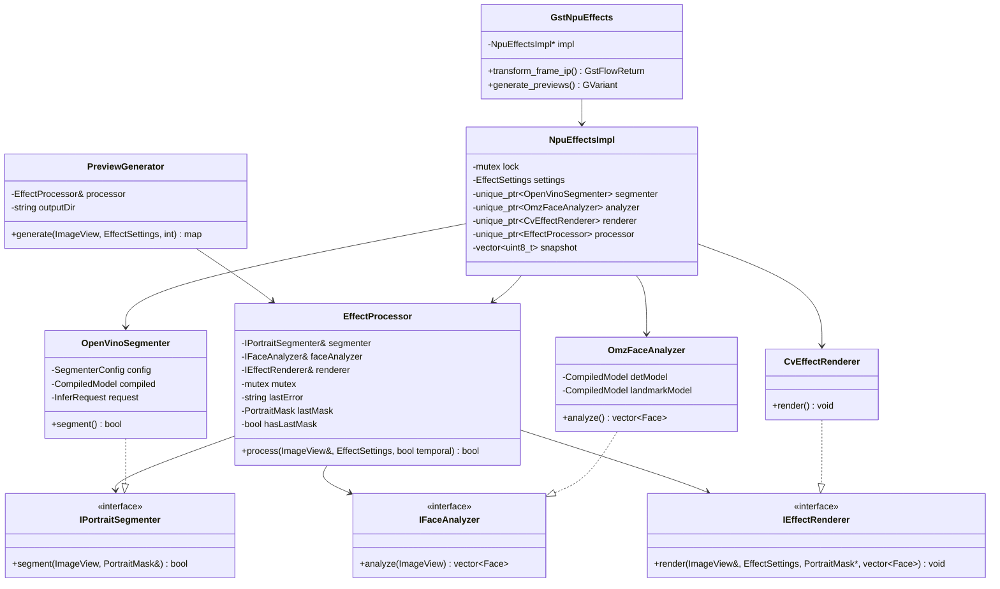
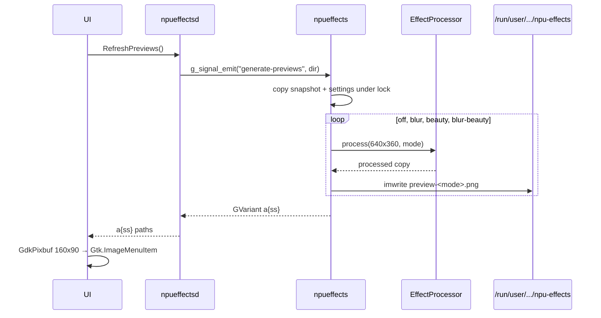

# C4 Level 4 — Code

## Назначение

Классы, пакеты, последовательности вызовов и инварианты потоков. Это
самый детальный уровень; он должен совпадать с кодом в `include/` и `src/`.

## Карта слоёв и файлов

| Слой | Каталог | Содержимое | Зависимости |
|---|---|---|---|
| Domain | `include/npucam/domain/` | `EffectMode`, `EffectSettings`, `ImageView`, `PortraitMask`, `Face`, порты | STL |
| Application | `include/npucam/application/`, `src/application/` | `EffectProcessor` | domain |
| Interface adapters | `include/npucam/{openvino,imaging,preview}/`, `src/{openvino,imaging,preview}/` | OpenVINO segmenter, OMZ face analyzer, OpenCV renderer, preview generator | application/domain + OpenVINO/OpenCV |
| Framework adapters | `src/gst/`, `src/daemon/`, `ui/` | GStreamer element, daemon/D-Bus, AppIndicator | GStreamer/GLib/GTK/D-Bus |
| Tests/tools | `tests/`, `src/tools/` | unit test, bench, CLI preview | core |

## Диаграмма классов



## Основные типы

| Тип | Поля/смысл |
|---|---|
| `ImageView` | `data`, `width`, `height`, `stride`; не владеет памятью; RGB24 |
| `PortraitMask` | `values` (float 0..1), `width`, `height`; разрешение модели |
| `RectF`/`PointF` | нормализованные координаты 0..1 относительно полного кадра |
| `Face` | `box`, `confidence`, `landmarks` (35 точек OMZ) |
| `EffectSettings` | `mode`, `gamma`, `blurStrength`, `smoothStrength` |
| `SegmenterConfig` | путь модели, размер входа, mean/scale, порядок RGB/BGR |

## Последовательность: кадр (on-demand)

```mermaid
sequenceDiagram
    participant C as camera pipeline (libcamerasrc)
    participant A as main appsrc
    participant G as npueffects
    participant P as EffectProcessor
    participant S as OpenVinoSegmenter
    participant F as OmzFaceAnalyzer
    participant R as CvEffectRenderer
    participant V as v4l2sink

    alt idle, no consumer
        Note over A: black timer pushes RGB 1280x720@30
    else consumer present
        C->>A: appsink sample (RGB); PTS cleared
    end
    A->>G: RGB 1280x720 buffer
    G->>G: caps check; copy settings under lock
    G->>P: process(frame, settings)
    alt mode has blur
        P->>S: segment(frame)
        S->>S: resize 256x256, NCHW, NPU infer
        S-->>P: mask 256x256 (0..1)
    end
    alt mode has beauty
        P->>F: analyze(frame)
        F->>F: face 300x300; landmarks 60x60 per face
        F-->>P: faces + 35 points
    end
    P->>P: EMA(lastMask, mask, motion gate)
    P->>R: render(frame, settings, mask?, faces)
    R->>R: gamma → blur/composite → skin smooth
    R-->>P: in-place pixels
    P-->>G: true
    G->>G: throttle snapshot (≤2 Hz)
    G-->>V: RGB buffer (converted to YUY2 later)
```

## Последовательность: превью



## Последовательность: смена режима

```mermaid
sequenceDiagram
    participant U as UI
    participant D as npueffectsd
    participant G as npueffects
    participant P as EffectProcessor

    U->>D: SetMode("blur-beauty")
    D->>G: g_object_set(mode)
    G->>G: lock; settings.mode = BlurBeauty
    Note over G: следующий transform_ip копирует настройки
    G->>P: process(..., BlurBeauty)
    U->>U: refresh state; ✓; refresh previews
```

## Потоки и блокировки

| Поток | Что делает | Блокировки |
|---|---|---|
| GStreamer streaming | `transform_frame_ip` | `impl->lock` только для копирования settings/snapshot; `EffectProcessor::mutex` внутри `process` |
| GLib main loop | D-Bus методы, bus watch, таймер активности | `impl->lock` через `set_property`; `EffectProcessor::mutex` через preview signal |
| UI main (GTK) | SNI, меню, синхронные D-Bus вызовы | нет общих C++-блокировок |
| systemd | рестарты | — |

**Порядок блокировок**: `impl->lock` всегда отпускается до вызова
`EffectProcessor::process`. Внутри `process` берётся только
`EffectProcessor::mutex`. Вложенных захватов нет, дедлока нет.

**Инференс**: один `ov::InferRequest` на адаптер; `EffectProcessor::mutex`
сериализует вызовы, поэтому streaming и preview не используют один request
одновременно.

**Snapshot**: копируется не чаще 2 раз в секунду под `impl->lock`;
preview получает копию, а не указатель на живой буфер.

## Ошибки

| Место | Поведение |
|---|---|
| `OpenVinoSegmenter`/`OmzFaceAnalyzer` конструктор | NPU → CPU fallback; при полном отказе — exception, element логирует и работает passthrough |
| `EffectProcessor::process` | ловит exceptions адаптеров, пишет `lastError_`, кадр не роняет |
| `CvEffectRenderer` | не бросает; некорректные настройки клампятся |
| daemon pipeline | `GST_MESSAGE_ERROR/EOS` → `failed=true` → выход с кодом 1 → systemd restart |
| D-Bus | неизвестный метод → `UnknownMethod`; UI ловит ошибки |
| UI | нет владельца D-Bus → иконка скрыта, polling продолжается |

## Инварианты

1. Элемент принимает и отдаёт только `video/x-raw,format=RGB`.
2. Обработка in-place; входной буфер GStreamer writable.
3. `EffectSettings` читаются под `impl->lock`; процессор получает копию.
4. `EffectProcessor::process` — единственная точка вызова моделей.
   Видео идёт с `temporal=true`, превью — с `temporal=false`.
5. Main appsrc pipeline всегда PLAYING; camera pipeline (libcamerasrc →
   appsink) в простое READY. Формат v4l2sink задаётся один раз.
5. Превью используют тот же `EffectProcessor`, что и видео (DRY).
6. `generate-previews` не линкует daemon с внутренностями элемента.
7. daemon — единственный процесс, владеющий `/dev/video60`.
8. UI не открывает камеру и не содержит логики эффектов.
