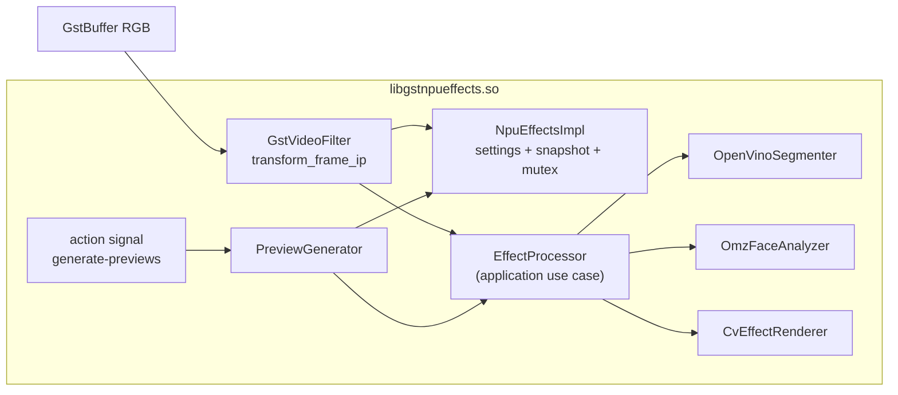
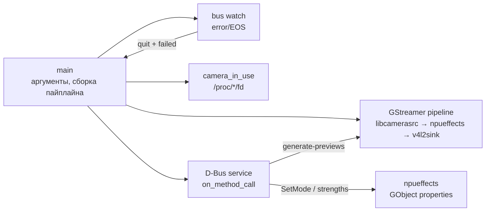
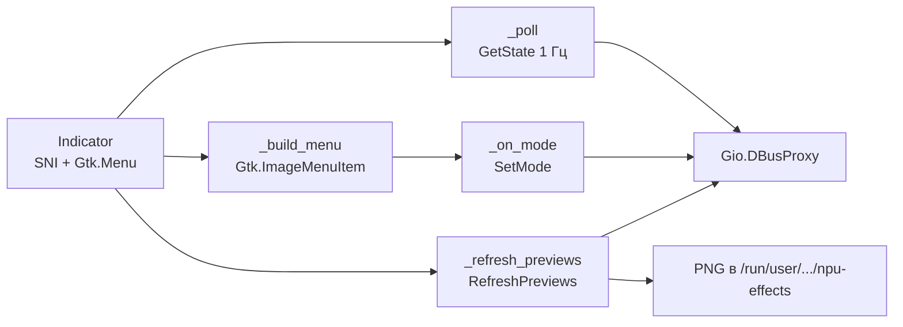

# C4 Level 3 — Components

## Назначение

Компоненты внутри контейнеров: что за модуль, за что отвечает, от чего
зависит и какие контракты пересекает. Стрелки зависимостей направлены
**внутрь** (к domain/application); инфраструктурные детали — снаружи.

## GStreamer-элемент `npueffects`



| Компонент | Файл | Ответственность | Зависит от |
|---|---|---|---|
| `GstNpuEffects` | `src/gst/gstnpueffects.cpp` | caps, свойства, in-place обработка, snapshot, action signal | GStreamer, `NpuEffectsImpl` |
| `NpuEffectsImpl` | там же | настройки, модели, мьютекс, последний кадр | адаптеры, `EffectProcessor` |
| `EffectProcessor` | `src/application/effect_processor.cpp` | оркестрация: gamma/blur/beauty, сериализация моделей, temporal mask (EMA) | порты domain |
| `OpenVinoSegmenter` | `src/openvino/openvino_segmenter.cpp` | RGB → NCHW → маска 256×256 + 3×3 median | OpenVINO, OpenCV resize/median |
| `OmzFaceAnalyzer` | `src/openvino/omz_face_analyzer.cpp` | лицо 300×300 → 35 точек на кропе 60×60 | OpenVINO, OpenCV |
| `CvEffectRenderer` | `src/imaging/cv_effect_renderer.cpp` | luma gamma, bokeh-фон; beauty: маска кожа (эллипс+яркость+landmarks), bilateral/glow/подъём | OpenCV |
| `PreviewGenerator` | `src/preview/preview_generator.cpp` | 4 режима → PNG 640×360 | `EffectProcessor`, OpenCV |

**Поток кадра**:

1. `transform_frame_ip` проверяет `GST_VIDEO_FORMAT_RGB`.
2. Копирует `EffectSettings` под `impl->lock`.
3. `EffectProcessor::process` (под своим мьютексом) вызывает порты.
4. `render` изменяет буфер на месте.
5. Раз в 500 мс копируется snapshot для превью.
6. Возвращает `GST_FLOW_OK`.

**Action signal** `generate-previews` принимает каталог, берёт snapshot,
рендерит 4 PNG через тот же `EffectProcessor` и возвращает `a{ss}`.

## Демон `npueffectsd`



| Компонент | Ответственность | Контракт |
|---|---|---|
| `main` | парсинг аргументов, main appsrc pipeline + camera pipeline, D-Bus, main loop | CLI |
| `build_pipeline` | production (appsrc) / test строка | GStreamer |
| `push_black` | чёрный кадр 1280×720@30 в appsrc при простое | GstAppSrc |
| `on_camera_sample` | appsink camera pipeline → appsrc (PTS сброшен, do-timestamp) | GstAppSink |
| `start_camera`/`stop_camera` | PLAYING/READY отдельного camera pipeline; применяет настройки | GStreamer |
| `on_method_call` | 7 D-Bus методов | `ru.fstronin.NpuEffects` |
| `camera_in_use` | поиск чужих PID с открытым `/dev/video60` | `/proc` |
| `update_active` | poll 200 мс, debounce 600 мс, idle 1 с, cooldown 1 с | GLib timeout |
| `on_bus_message` | ошибки/EOS main pipeline → выход | GstBus |

D-Bus XML — единственный контракт UI; daemon не импортирует код UI и не
линкуется с элементом (элемент загружается как плагин). Main pipeline
(appsrc → npueffects → v4l2sink) всегда PLAYING; camera pipeline
(libcamerasrc → appsink) живёт отдельно и в простое READY, поэтому
физический сенсор/LED выключены, а `v4l2sink` не пересогласует формат.

## UI `npu-effects-indicator`



| Компонент | Ответственность |
|---|---|
| `Indicator.__init__` | D-Bus proxy, SNI item, меню, первый poll |
| `_poll` | активность/режим; ACTIVE/PASSIVE; refresh при переходе в active; refresh каждые 5 с |
| `_build_menu` | 4 пункта с `Gtk.ImageMenuItem`, заголовок, separator, «Обновить превью» |
| `_refresh_previews` | `RefreshPreviews` → `GdkPixbuf` 160×90 → `icon-data` |
| `_on_mode` | `SetMode`, обновление галочки, обновление превью |
| `_apply_mode` | префикс `✓` у выбранного режима |

UI не содержит логики эффектов и не открывает камеру. Это позволяет
перезапускать daemon независимо.

## Сквозные интерфейсы

### GObject-свойства элемента

| Свойство | Тип | Смысл |
|---|---|---|
| `mode` | string | `off`, `blur`, `beauty`, `blur-beauty` |
| `gamma` | double | luma gamma, соглашение GStreamer: выход = вход^(1/gamma) |
| `blur-strength` | double | 0..1 |
| `smooth-strength` | double | 0..1 |
| `model-dir` | string | каталог моделей |
| `device` | string | `NPU` или `CPU` |

### D-Bus

```xml
<interface name="ru.fstronin.NpuEffects">
  <method name="SetMode"><arg type="s" direction="in"/></method>
  <method name="SetGamma"><arg type="d" direction="in"/></method>
  <method name="SetBlurStrength"><arg type="d" direction="in"/></method>
  <method name="SetSmoothStrength"><arg type="d" direction="in"/></method>
  <method name="GetState"><arg type="a{sv}" direction="out"/></method>
  <method name="RefreshPreviews"><arg type="a{ss}" direction="out"/></method>
  <method name="Quit"/>
</interface>
```

`GetState` возвращает `active`, `mode`, `gamma`, `blur`, `smooth`,
`device`. `active` вычисляется по наличию **чужого** PID с открытым
`/dev/video60`.

## Правило зависимостей

```
domain ← application ← adapters (OpenVINO/OpenCV/GStreamer/D-Bus/UI)
                         ↑
                   frameworks/drivers
```

- `domain` не знает про OpenVINO, OpenCV, GStreamer, GTK.
- `application` знает только порты.
- Адаптеры реализуют порты и зависят от фреймворков.
- UI и daemon общаются через D-Bus, а не через общие C++-заголовки.
- Daemon и элемент общаются через публичный GStreamer-контракт
  (свойства + signal), а не через линковку внутренностей.
