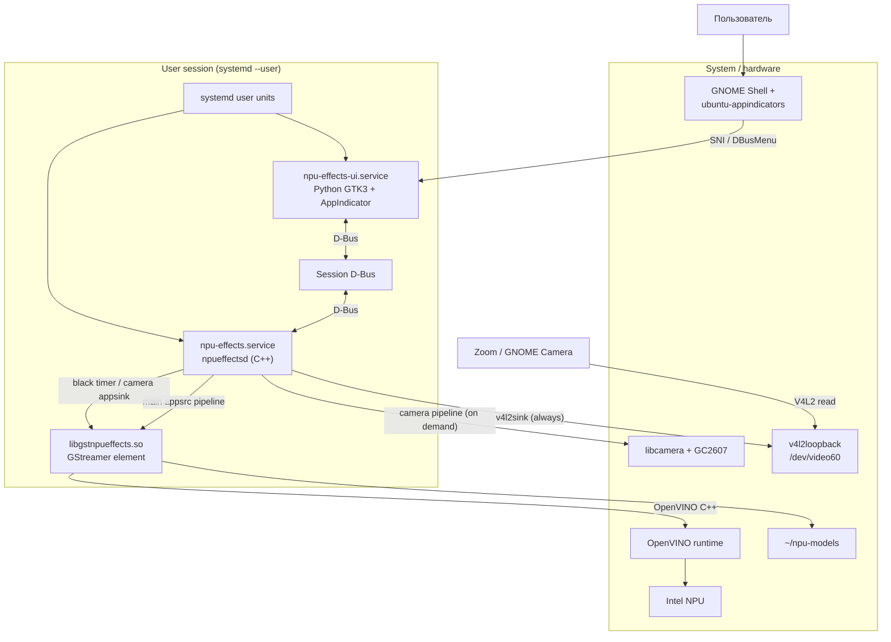

# C4 Level 2 — Containers

## Назначение

Контейнеры — процессы, разделяемые библиотеки и хранилища, из которых
состоит система. Диаграмма показывает, кто владеет камерой, кто говорит по
D-Bus и где выполняется инференс.

## Контейнеры

| Контейнер | Технология | Ответственность | Входы | Выходы |
|---|---|---|---|---|
| `npueffectsd` | C++17, GLib/GIO, GStreamer | main appsrc pipeline (всегда) + camera pipeline (on demand); чёрный placeholder; D-Bus; активность; превью | V4L2/libcamera, D-Bus | `/dev/video60`, D-Bus |
| camera pipeline | GStreamer, libcamerasrc | отдельный pipeline сенсора; READY в простое, PLAYING при потребителе | libcamera | appsink → appsrc |
| `libgstnpueffects.so` | C++17, GStreamer video filter | кадр RGB → эффекты → RGB; action signal превью | GStreamer buffers | GStreamer buffers, PNG |
| `npu-effects-indicator` | Python 3, GTK3, AyatanaAppIndicator | SNI-иконка, меню, превью, D-Bus-клиент | D-Bus, PNG | SNI + DBusMenu |
| Session D-Bus | systemd/D-Bus | контракт UI ↔ daemon | методы | ответы |
| `npu-effects.service` | systemd user unit | жизненный цикл daemon | — | процесс |
| `npu-effects-ui.service` | systemd user unit | жизненный цикл UI | — | процесс |
| libcamera + GC2607 | system libs | сенсор и простой ISP | сенсор | GStreamer source |
| v4l2loopback | kernel module | виртуальная камера | записи daemon | чтение приложениями |
| OpenVINO + NPU plugin | Intel runtime | инференс моделей | тензоры | маски/боксы/точки |
| `~/npu-models` | файлы | ONNX/IR веса | — | модели |
| `ubuntu-appindicators` | GNOME Shell extension | рендер SNI в панели | SNI/DBusMenu | иконка и меню |

## Диаграмма контейнеров

## Протоколы и форматы

| Граница | Протокол | Формат |
|---|---|---|
| libcamera → element | GStreamer caps | `video/x-raw,format=RGB,width=1280,height=720,framerate=30/1` |
| element → v4l2sink | GStreamer caps | `video/x-raw,format=YUY2,width=1280,height=720` |
| camera pipeline → daemon | GStreamer appsink | RGB 1280×720@30 sample |
| idle → main appsrc | GStreamer buffer | чёрный RGB 1280×720@30 |
| UI ↔ daemon | D-Bus | методы `SetMode`, `SetGamma`, `SetBlurStrength`, `SetSmoothStrength`, `GetState`, `RefreshPreviews`, `Quit` |
| daemon → element | GObject | свойства `mode`, `gamma`, `blur-strength`, `smooth-strength`, `model-dir`, `device`; action signal `generate-previews` |
| element → daemon | GStreamer signal | `GVariant a{ss}` (режим → путь PNG) |
| UI → Shell | StatusNotifierItem + DBusMenu | `icon-data` = PNG bytes (`ay`) |
| element → NPU | OpenVINO C++ | f32 NCHW тензоры |
| daemon → файлы | POSIX | `/run/user/<uid>/npu-effects/preview-*.png` |

## Владение состоянием

- **Камера**: физический сенсор открыт только camera pipeline внутри
  `npueffectsd` и только пока есть потребитель `/dev/video60`; в простое
  READY. `/dev/video60` при этом всегда имеет producer (чёрный кадр). Конфликт решён маской
  `gc2607-vcam.service` в `scripts/use-effects-vcam.sh`.
- **Режим эффекта**: daemon (в памяти) → свойство элемента; UI только
  отображает и меняет через D-Bus.
- **Превью**: element (последний кадр, throttle 2 Гц) → файлы
  `/run/user/<uid>/npu-effects`; UI читает их.
- **Модели**: `~/npu-models`, общие для daemon/CLI; версионируются
  скриптом загрузки.

## Развёртывание

- User units запускаются после `graphical-session.target`.
- `npu-effects.service` имеет `Conflicts=gc2607-vcam.service`; старый
  relayd маскируется.
- `npu-effects-ui.service` зависит от `graphical-session.target`, но не
  требует daemon (переживает его рестарт, опрашивая D-Bus).
- Модели и OpenVINO-библиотеки — в `$HOME`; системные пакеты не
  модифицируются, кроме маски user-юнита (обратимо).

## Отказы и деградация

| Отказ | Поведение |
|---|---|
| Модель не загрузилась | element логирует и пропускает кадры без эффектов; пайплайн жив |
| NPU недоступен | адаптеры компилируют модель на CPU и логируют fallback |
| daemon упал | systemd перезапускает (`Restart=on-failure`), UI скрывает иконку и восстанавливается по polling |
| UI упал | камера продолжает работать; systemd перезапускает UI |
| ошибка camera pipeline | возврат к чёрному потоку, повтор через 2 с; main pipeline жив |
| рестарт daemon при активном потребителе | возможен EBUSY на S_FMT; штатно сервис не перезапускается |
| Нет потребителя камеры | daemon пишет кадры в loopback, `Active=false`, иконка скрыта |
