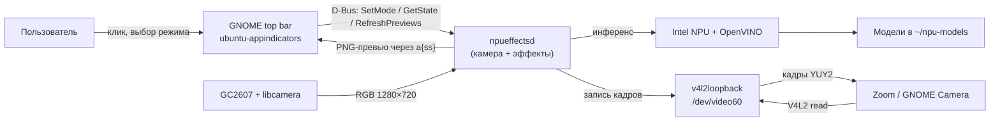

# C4 Level 1 — System Context

## Назначение

`NpuCamFX` — локальная система эффектов для камеры ноутбука:
портретное размытие фона и «украшательства» (сглаживание кожи) в реальном
времени, с управлением из верхней панели GNOME. Вся обработка выполняется
локально; видео никуда не отправляется.

Документ описывает **границы системы**, внешних акторов и системы, а также
протоколы на границах. Уровни 2–4: [c4-containers.md](c4-containers.md),
[c4-components.md](c4-components.md), [c4-code.md](c4-code.md).

## Акторы и внешние системы

| Элемент | Тип | Ответственность | Интерфейс к системе |
|---|---|---|---|
| Пользователь | актор | включает камеру, выбирает эффект, оценивает превью | верхняя панель GNOME (клик по иконке) |
| Zoom / GNOME Camera / любое V4L2-приложение | внешняя система | захватывает видео для звонка/снимка | читает `/dev/video60` (V4L2, YUY2 1280×720) |
| GC2607 + libcamera | внешняя система | сенсор и простой ISP | GStreamer `libcamerasrc` |
| v4l2loopback | ядро/драйвер | виртуальная камера | V4L2 device `/dev/video60` |
| Intel NPU + OpenVINO | внешняя система | ускоритель инференса | OpenVINO C++ API, `/dev/accel/accel0` |
| GNOME Shell + `ubuntu-appindicators` | внешняя система | отрисовка StatusNotifierItem в верхней панели | SNI + `com.canonical.dbusmenu` |
| Session D-Bus | инфраструктура | связь UI ↔ daemon | `ru.fstronin.NpuEffects` |

## Контекстная диаграмма

## Что входит в систему

- GStreamer-элемент `npueffects` (inference + пиксельная обработка).
- Демон `npueffectsd` (владение пайплайном, D-Bus, активность камеры,
  генерация превью).
- Верхнепанельный контрол `npu-effects-indicator`
  (StatusNotifierItem/AppIndicator, меню с превью).
- systemd-юниты `npu-effects.service`, `npu-effects-ui.service`.
- Модели и их загрузчик (`scripts/download-models.sh`).

## Что не входит

- libcamera/ISP и драйвер сенсора GC2607 (используются как есть).
- Приложения Zoom/Snapshot (потребители виртуальной камеры).
- Облачные сервисы, запись видео, телефония.
- Замена системного тюнинга камеры (`/usr/share/libcamera/ipa/simple/gc2607.yaml`).

## Ключевые ограничения и качества

| Качество | Требование/факт |
|---|---|
| Задержка | обработка кадра ≤ 33 мс, живой пайплайн держит 30 fps |
| Приватность | все модели и кадры локальны, сеть не используется |
| Платформа | Ubuntu 26.04, GNOME Shell 50.1, Wayland, Intel Core Ultra 7 155H |
| Ускоритель | Intel NPU через OpenVINO 2026.4.1; CPU fallback |
| Формат | RGB внутри элемента, YUY2 1280×720 на виртуальной камере |
| Управление | верхняя панель, без перезапуска сессии |
| Отказоустойчивость | daemon перезапускается systemd; при ошибке модели — passthrough |

## Сценарии верхнего уровня

1. **Звонок с размытием**: пользователь открывает Zoom → приложение читает
   `/dev/video60` → daemon видит потребителя → в панели появляется иконка →
   пользователь выбирает «Размытие фона» → кадры идут с размытым фоном.
2. **Украшательства**: пользователь выбирает «Украшательства» → NPU находит
   лицо и 35 точек → сглаживается кожа без глаз/рта.
3. **Превью**: при активации камеры и раз в 5 с daemon рендерит 4 PNG; UI
   показывает их как `icon-data` в пунктах меню.
4. **Возврат**: пользователь запускает `scripts/restore-relayd.sh` → маска
   снимается, старый `gc2607-vcam.service` снова владеет камерой.
